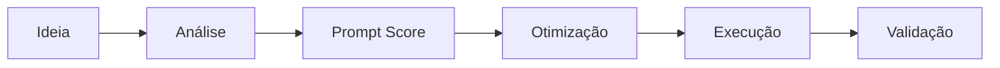

# Prompt Master: Engenheiro de Prompts IA

Um método para transformar pedidos vagos à IA em prompts claros, avaliáveis e reutilizáveis, documentado como **Instrução de Trabalho (IT)**, no mesmo padrão que eu usava em Sistemas de Gestão da Qualidade.

A ideia central: um prompt é um processo. Ele tem entrada, critérios, saída e validação. Dá para medir a qualidade dele antes de executar.

---

## Como funciona

1. **Classifica o pedido** em um de seis modos: Criar, Analisar, Prompt Score, Otimizar, Converter ou Executar.
2. **Diagnostica** o que falta: objetivo, contexto, público, entradas, restrições e formato.
3. **Dá uma nota de 0 a 10** (Prompt Score) com base em 9 critérios.
4. **Reestrutura** o prompt em 8 elementos: Papel, Contexto, Objetivo, Tarefa, Entradas, Restrições, Formato de saída e Critérios de qualidade.
5. **Valida** a resposta da IA com um checklist, que inclui verificar se há informação inventada.

## Exemplo: antes e depois

**Antes** (Prompt Score 2/10):
> Faça um relatório sobre uma empresa.

**Depois:**
> **Papel:** analista de negócios.
> **Contexto:** vou apresentar a empresa [NOME] para a diretoria, que avalia uma parceria.
> **Objetivo:** mostrar se a empresa é uma parceira confiável.
> **Tarefa:** resumir histórico, produtos, situação financeira e riscos.
> **Entradas:** [colar dados ou links].
> **Restrições:** usar só as informações fornecidas; marcar como "a confirmar" o que não estiver nelas.
> **Formato:** 1 página, com tópicos e uma recomendação final em 2 linhas.
> **Critérios de qualidade:** cada afirmação deve ter fonte; separar fatos de opiniões.

## Diferencial

- **Abordagem de Qualidade aplicada à IA:** critérios objetivos de avaliação, padronização e validação do resultado.
- **Regras contra alucinação:** não inventar fatos, separar fatos de hipóteses e usar placeholders quando faltar dado.
- **Pragmatismo:** quando o pedido é para executar uma tarefa, o método executa, em vez de devolver um prompt.

## Como usar

O texto da [Instrução de Trabalho](docs/IT-PM-001_instrucao_de_trabalho.md) pode ser colado como instruções personalizadas de um assistente de IA, por exemplo um Projeto no Claude, um GPT personalizado ou um Gem no Gemini. Depois disso, basta descrever a necessidade em poucas palavras.

## Documentação

- [IT-PM-001: Instrução de Trabalho do Prompt Master](docs/IT-PM-001_instrucao_de_trabalho.md)

---

**Pedro Henrique Simas**: Qualidade, Processos e Requisitos | Salvador, BA  
[LinkedIn](https://www.linkedin.com/in/pedro-henrique-simas/)
